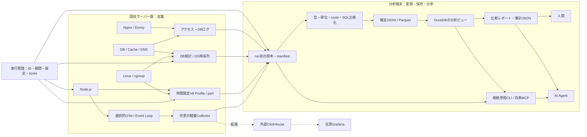

# ISUCON向けNode.js計測・AI分析基盤

状態：設計提案。実装なし。2026-10-12。

推奨は、**ベンチマークごとの計測結果を束ねて比較する、Node.js向けのpproteinに近いツール**。最初から総合Observabilityサービスを作るのは過剰設計。既存CLIと実行単位のファイル保存を土台にし、DuckDBで分析、必要時だけOTel TraceとCPU Profileを追加する。

ClickHouseは有力な拡張先だが必須ではない。「根拠を失わずに短時間で次の改善を判断できるか」を採用基準にする。以下の数値は検証開始値であり実測値ではない。公式資料の確認範囲は[参考資料](references.md)に記す。

## A. 要件整理

| 区分 | 要件 |
|---|---|
| 必須 | 実行ID、ベンチ原本、コード・設定・計測条件の記録、実行間比較 |
| 必須 | 全体の負荷を把握する集計と、原因を掘る限定的な詳細計測 |
| 必須 | Nodeの起動設定で導入できる基本計測、完全OFF・撤去手順 |
| 必須 | 計測経路の障害・欠損を把握でき、保存先障害でアプリを待たせない |
| 必須 | 人とAIが同じ根拠にアクセスし、観測・仮説・検証結果を区別する |
| 必須 | 計測ON/OFFによるスコア差を測定する |
| 推奨 | Node CPU Profile、Event Loop、DB集計とサンプルTraceの相互参照 |
| 推奨 | 複数サーバーの時刻・resource識別、分析端末への転送 |
| 推奨 | route/query正規化ルールの版管理、原本から再集計できること |
| 初期には不要 | 全プロトコル対応、全件Trace、常時Profile、全操作の手動Span |
| 初期には不要 | Kubernetes、Kafka、HA、長期保管、独自APM、専用Trace描画実装 |
| 初期には不要 | AIによる自動変更・自動EXPLAIN ANALYZE、MCPの必須化 |

「全件」は収集対象の全件という意味。Nginxアクセスログにも未完了リクエストや欠損があり、DB統計にも対象外の実行がある。無条件に完全な母集団とはみなさない。

汎用性は巨大なplugin frameworkで実現しない。最初はNginx、MySQL、Node、Linuxの明示的な収集器と共通manifestだけにする。後から必要になった入出力契約を共通化する。

## B. 技術選定

### 保存・分析構成

| 構成 | 導入・運用 | 分析の強み | 制約 | 判断 |
|---|---|---|---|---|
| OTel + ClickHouse + Grafana | 常駐DB・Collector・権限・TTL・スキーマ・dashboardが必要 | SQLでTrace、Log、query統計を横断、同時分析 | 小さいinsert、merge、AIの重いSELECT、Metric集計の正確性を管理 | 拡張候補 |
| OTel + Jaeger + Prometheus | TraceとMetric用の別サービス。診断用途なら小さく試せる | Trace閲覧、PromQL、既存dashboard | Logとbenchmark保存は別途、横断分析は複数API | Trace UIを重視する場合 |
| OTel + Tempo + Prometheus + Grafana | 保存・配置・retentionを準備する必要 | Grafana上のTrace/Metric連携 | 構成要素が多い。小規模でも準備なしの当日導入には不向き | 事前に運用経験がある場合 |
| 構造化ログ・統計 + DuckDB | 常駐DB不要、分析端末で実行 | SQL比較、原本保持、可搬性 | 標準Trace UIなし、型・変換・ファイル確定が必要 | 基本案 |
| ALP/pt-query-digest/perf中心 | 導入最短。既存知識を活かす | endpoint/SQL/OSの一次調査 | 因果関係と実行間比較が弱い | MVPの収集・照合手段 |
| pproteinのNode対応拡張 | 既存収集・表示を再利用できる可能性 | ツール統合の方向性が近い | Node Profile形式と既存設計の適合性が未検証 | PoCで比較 |

DuckDBは複数Parquetファイルを分析できる。MVPでは確定済みファイルを読み、同じDBファイルを複数プロセスで書き換えない。[公式Parquet資料](https://www.duckdb.org/docs/current/data/parquet/overview)、[concurrency資料](https://duckdb.org/docs/lts/connect/concurrency)。

OTelとDuckDBは排他的ではない。CollectorのOTLP出力を原本保存し、分析時に必要な列を変換する。OTLP JSONは単純な「一行一Span」のNDJSONとは限らないため、変換を小さな明示的処理として扱う。

### ClickHouseが必要になる条件

データ量、同時分析人数、速報の必要性、分析待ち時間を実測して判断する。専用分析端末に置けるなら競技サーバーとの資源競合を避けられるが、ネットワーク転送とSDK負荷は残る。

概算は `Trace件数 = RPS × 実行秒 × sampling率 × 平均Span数`。仮に10,000 RPS、60秒、1%、10 Spanなら60,000 Span。1 Spanを1 KBと仮定すると約60 MB。全件なら約6 GBになる。これは計画用の仮定で、圧縮率、SQL長、index、原本と変換後の重複は含まない。1 requestあたり500 Bのログなら同じ実行で約300 MBを追加する。

ClickHouse採用時も最初はraw保存と少数の分析ビューに限定する。大量のMaterialized Viewや専用query engineは作らない。time/resourceに合わせたsort key、TTL、batch insert、SELECT権限、query資源制限を事前準備する。runごとに細かいpartitionを増やす設計は避ける。

### 参考記事の評価

参考記事は、外部のClickHouseで加工・集計し、NginxとアプリのTraceを辿る有用性を示している。一方で専用テーブル、Materialized View、path辞書の運用があり、重いSQLによるメモリ不足にも言及している。Goでの実績をNode SDKの低負荷実績に置き換えることはできない。[参考記事](https://nonylene.hatenablog.jp/entry/2024/12/09/010951)。

記事の旧HTTP属性やスキーマをコピーしない。現行instrumentationが出す属性を確認し、入力版と変換版を固定する。Collector処理を減らす判断は有用だが、秘密情報除去やサイズ上限は保存前に必要であり、すべてをDB側へ後送りしない。

### pproteinから取り入れるもの

公開リポジトリはGo向けでpprof/fgprof/alp/slp連携を掲げ、Goフレームワークintegrationとstandaloneを持つ。全機能の移植可能性は未監査。[pprotein](https://github.com/kaz/pprotein)、[integration](https://github.com/kaz/pprotein/tree/main/integration)。

取り入れる設計は、計測開始・終了、成果物収集、実行一覧、比較、メモ、根拠への導線。置き換える計測は以下。

| Go中心の機能 | Node向け候補 | 同等でない点 |
|---|---|---|
| pprof CPU | V8/Inspector `.cpuprofile` | isolate単位。formatと表示ツールが異なる |
| fgprofのwall time調査 | Trace + Event Loop + OSのoff-CPU調査 | 単一Profileで同じ情報を得られるとは限らない |
| Go heap/goroutine調査 | GC指標、RSS/heap、必要時allocation sampling | Worker・async待機をgoroutineのように一覧化できない |
| ALP等の結果収集 | 継続利用 | runtimeに依存しない部分を活用 |

V8 CPU ProfileはInspectorで取得できる。heap snapshotは停止時間・メモリ影響が大きくなり得るため、通常のベンチ中には取得しない。[Node Inspector](https://nodejs.org/api/inspector.html)。

実装言語はこの段階では未決定。対象アプリがNodeであることと、収集CLIまでNodeで書くことは別の判断。既存pproteinへNode収集器を足す案と、最小CLIを新規作成する案をPoCで比べる。

## C. アーキテクチャ

### 実行管理

実行の状態は `prepared → collecting → benchmark_finished → draining → sealed`。中断は`aborted`、欠損のある実行は品質情報を持つ。score取得完了とtelemetry収集完了を分ける。

1. 計測設定、コードhash、設定hash、DB/Node版、対象host、sampling率を記録。
2. 時計差を確認し、DB累積統計とログoffsetを保存。計測準備の再起動はベンチ前に終える。
3. benchmarkのinitialize/warmup/load等を判別できるならphaseを記録。不明なら不明とする。
4. 同じ対象で重複した実行を開始させない。手動実行は明示的な時間窓で取り込む。
5. benchmark終了後、DB統計、ベンチ原本、Profile、ログ終端を回収。SDK export・ログbufferを待つ時間には上限を置く。
6. 各hostの回収結果、欠損、遅延到着を確認してseal。後着データを別runへ付け替えない。

実行IDをCollectorの「現在値」で全データへ一括付与すると、遅延exportが次runへ混入する。manifestのevent-time窓と発生元情報で所属を判定する。専用run resourceをNodeへ渡す方式は確実だが、毎回再起動するとcache条件が変わるのでMVPでは常用しない。

保存はrun/host/signalで分離し、未確定ファイルを分析対象に含めない。巨大なファイルを毎回全コピーせずinode/offsetを管理する。rotationや再起動でoffsetが無効になったら検出する。原本にchecksum、parser版、収集元を付ける。

### 配置・運用モード

| モード | 内容 | 目的 |
|---|---|---|
| OFF | preloadなし、追加polling/profile/exportなし | 最終scoreと計測負荷の基準 |
| LIGHT | 必要なaccess log、DB前後統計、低頻度OS指標 | 一次分析 |
| DIAGNOSTIC | LIGHT + head-sampled Trace + Event Loop | 因果関係の調査 |
| FOCUSED | 対象route・queryの詳細、短時間CPU Profile | 仮説の検証 |

SDK/exporter/Collectorのqueueは有限、exportは非同期、timeout・retryに上限を置く。満杯ではtelemetryを捨て、その件数を記録する。リクエスト処理から同期disk書込みやexport完了待ちをしない。ただしSDKのCPUやメモリ消費まで隔離できるわけではなく、障害注入で確認する。

Collectorは必要になった場合だけ各hostに置き、memory limitとcgroup制限を設定する。中央Collectorに直接送る案はlocalプロセスを減らせるが通信障害への依存が増える。外部分析先が使えない場合は短時間のbounded spoolに保存し、ベンチ後に分析する。disk spoolもDBとI/O競合するため無制限にしない。永続queueは必須にせず、欠損を許してアプリを守る。

### Sampling

初期候補はparent-basedのhead samplingを1〜5%から検証する。親samplingをベンチクライアント等が決めている場合は実効率を確認する。Trace件数をRPSの母集団にしない。全体件数はアクセスログやsamplingと独立したcounterから得る。

低率head samplingでは「遅いrequestを必ず保存」「全error保存」は実現できない。必要なら別counter/logまたは短い対象限定診断を使う。tail samplingは全SpanをSDKから送るためアプリと通信の負荷を削減しない。Collectorの状態保持とstream完了待ちが必要で、MVPでは採用しない。[Tail sampling仕様](https://github.com/open-telemetry/opentelemetry-collector-contrib/blob/main/processor/tailsamplingprocessor/README.md)。

設定変更は原則run境界。動的sampling変更はSDK設定だけで可能と仮定せず、対応を検証する。0%と完全OFFを別扱いにする。

## D. 計測対象マトリクス

負荷の「低・中・高」は相対的な設計評価で、%の実測ではない。頻度、payload、query数、Span数で逆転する。「改修なし」はソース変更なしであり、設定変更やrestartが不要という意味ではない。

| 対象 | 計測値・発見できる制約 | 自動OTel / 手動 | 改修なしの代替 | 負荷・取得制約 |
|---|---|---|---|---|
| Nginx | 件数/status/bytes、request、upstream connect/header/response時間、retry、active connection | moduleが使える場合のみTrace。MVPはJSON log | access log + ALP、stub_status | logは低〜中、全件I/O増。完了時記録。module導入にbinary互換性制約 |
| Envoy / 他proxy | upstream/pending request、retry、connection、response flags、HTTP/2制限 | Envoyのtracing設定等。製品別に確認 | access log、admin metrics | 設定のみで可能なことが多い。requestにqueue時間が含まれるか定義確認 |
| Node HTTP/1.1 | server/client duration、route、status、並列数、timeout | HTTPとframeworkの対応版を選択 | proxy log、診断用eBPF | 中。routeはframework情報が必要。preloadの順序、ESM、bundleで欠落し得る |
| Node HTTP/2 | stream数、duration、reset、flow control | HTTP/1のinstrumentationが対応すると仮定しない | edge metrics/log、必要なstream hook | 中。connectionとstreamを別計数。native http2の対応はPoCが必要 |
| Event Loop / GC | delay分布、ELU差分、GC時間、heap/RSS | runtime instrumentationの対象版確認、またはpreloadでperf_hooks | CPU Profile、pidstat | 低〜中。delayはtimer sampling。ELUはCPU使用率ではない |
| handler | 処理区間、encode、ループ、queue待ち | framework Spanは補助。意味ある区間は手動 | V8 CPU Profile | 細かすぎるSpanは高負荷。非同期Spanの空白はCPU時間ではない |
| MySQL / PostgreSQL client | query/API duration、回数、error、接続先、query text | mysql/mysql2/pg等は実際のドライバー版とhookを確認 | server統計・slow log | query数に比例。pool取得待ちがSpanに含まれるとは限らない。対象APIの始点終点を検証 |
| SQLite client | statement duration、回数、busy/lock、同期呼出し | bindingごとに確認。非対応ならwrapper/native hook | SQLite trace/profile callback、OS/Profile | 別DBサーバーなし。bindingがhookを公開しなければ改修が必要。同期SQLでEvent Loopが止まり得る |
| MySQL server | digest件数/時間/rows examined、lock、buffer、connection | JS自動計測の対象外 | Performance Schema前後差分、slow log、pt-query-digest | 低〜高。slow閾値以下を観測できない。全query logは重い。digest容量とrestartに注意 |
| PostgreSQL server | queryid別calls/time/rows、block I/O、wait/lock | exporter/receiverは版を確認 | pg_stat_statements、pg_stat_activity、log | extension導入にpreload/restartが必要な場合。queryidはTrace IDではない |
| Redis | command/API時間、hit/miss、eviction、memory、connection | redis/ioredis等の版を確認。業務hit/missは手動 | INFO、SLOWLOG、latency統計 | 低〜中。global hit率をendpoint hit率とみなさない。pipelineを単純比較しない |
| Memcached | get/set時間、hit/miss、eviction、connection | 使用clientの対応を確認、必要ならwrapper | stats polling | 低〜中。server statsからrequestの因果関係は復元できない |
| gRPC unary | method/status、client/server latency | Node gRPC instrumentationの実使用版確認 | proxy log、grpc metrics | 中。HTTP/2対応とgRPC対応を同一視しない |
| gRPC streaming | connection/RPC寿命、message処理、queue、backpressure | RPC Spanだけでは不足。message hookは手動 | proxyのbytes/reset、限定Profile | message毎のTraceは高負荷。serialize/write時間は配送完了ではない |
| SSE | active connection、first event、events/bytes、heartbeat、再接続、write待ち | HTTP Spanは寿命。生成・処理区間は手動 | proxy connection metrics、限定ログ | 長寿命Spanは終了まで届かない場合。proxy bufferingとclient速度を区別 |
| WebSocket | handshake、接続数/寿命、message rate、処理時間、buffer/close | handshakeやSocket.IO対応とraw WS message対応は別。手動hook | proxy bytes/connection、packet/eBPF | frame/message/業務operationは別。payloadを収集しない。因果IDなしではmessage間を厳密JOINできない |
| Node DNS | resolve時間、error、timeout、cache、libuv queue | dns instrumentationはAPIと版を確認 | 限定packet計測、resolver統計 | dns.lookupとresolveは経路が異なる。query名をmetric labelにしない |
| PowerDNS | QPS、latency統計、rcode、cache、backend時間、queue/drop | 直接Spanを必須にしない | /metricsまたは統計API、dnsdist統計、限定dnstap/packet | 低〜中。Authoritative/Recursor/dnsdistで別仕様。DNS transaction IDは16bitでTrace IDの代わりにならない |
| Linux / Docker | core/PID CPU、RSS、fault、swap、PSI、disk latency/queue、net drops/retransmit、cgroup throttle | hostmetrics等は存在するが対象counterと権限を確認 | vmstat/pidstat/iostat/sar/ss、procfs/cgroup | pollingは低〜中。containerからhostが見えない場合。host CPU%だけでは1 core飽和を逃す |
| CPU / off-CPU Profile | JS/native hot stack、scheduler待ち、I/O待ち | OTel Profile統一を必須にしない | V8 Inspector、perf、対象限定eBPF | 中〜高・環境依存。symbol、kernel権限、JIT、sampling bias、Worker/isolate範囲を記録 |

JS自動計測はライブラリごとに対応範囲が異なり、内部コードは通常自動では計測されない。[JS公式資料](https://opentelemetry.io/docs/languages/js/libraries/)。

Nginxの時間は秒単位で、upstream retry時は複数値になる。`request_time - upstream_response_time`を「proxy CPU時間」と呼ばない。client upload/download、buffering、retry等を含み得る。[Nginx公式資料](https://docs.nginx.com/nginx/admin-guide/monitoring/logging/)。

Event Loop delayはnsからsへ変換する。ELUが高くても同期的待機の可能性があり、CPU飽和の証明にはならない。worker別、process CPU、cgroup throttle、Profileと合わせる。[Node perf_hooks](https://nodejs.org/api/perf_hooks.html)。

### 長時間接続：寿命・処理・配送を分ける

SSE/WS/gRPC streamingは三層で測る。

1. 接続：開始・終了、active、close理由、接続寿命、handshake/first response。
2. 処理：message/eventの受信から業務処理終了までを短いSpanまたはhistogramで記録。queue待ちとhandlerを必要に応じて分離。
3. 送信：serialize時間、write buffer、backpressure、drain待ち、events/bytes。client受信までの遅延は受信側の観測やackがなければ不明。

接続寿命のSpanと業務Spanを区別し、通常HTTPのlatencyランキングからstream routeを外す。接続がrunを跨ぐ場合は接続開始runだけに全処理を付けず、messageの発生時刻で所属を判定する。終了しない接続もactive gaugeとmessage集計で把握する。

同じTraceへ無制限のmessage Spanを追加しない。業務operation単位の短いTraceを作り、明示的な因果関係がある場合だけSpan Linkを使う。connection IDはlog/span用の独自属性で、metric labelにはしない。message count/histogramは集計し、Traceはsampleする。Event Loop上の同時並行処理を接続寿命から差し引いて「idle」と計算しない。

PowerDNS AuthoritativeはPrometheus形式の`/metrics`と統計APIを持つ。ただしRecursor/dnsdistへの同一設定適用は別途確認する。[公式API](https://doc.powerdns.com/authoritative/http-api/index.html)。DNSとbackend SQLの厳密なTrace連結は初期目標にせず、同じhost・backend・時間窓の相関で扱う。

## E. データモデル

### 標準と独自の境界

標準はOTLPのTrace/Metric/Log構造とSemConv。独自は競技run、query fingerprint、成果物参照、品質情報に限定する。保存テーブルの列名は分析用projectionであり、SemConvを独自置換するものではない。

| データ | 表現 | 必須の意味・範囲 |
|---|---|---|
| Trace | OTLP Span原本 + 必要列のprojection | trace/span/parent ID、kind、start/end、status、resource、scope |
| Metric | OTLP/OpenMetrics原本、型を保持 | counter/gauge/histogram、unit、temporality、start/end、bucket |
| Log | OTLP Logまたは構造化Logの対応表 | event time、observed time、body、severity、任意trace/span ID |
| Profile | `.cpuprofile`、perf等の原本とmanifest | PID/isolate、期間、sampling設定、symbols、format、path/hash |
| Benchmark Result | 独自run manifest + ベンチ出力原本 | score、pass/fail、エラー、期間、phase、コード/設定/データ条件 |
| DB Query Statistics | server統計の前後snapshotと差分 | source、DB、digest/queryid、count、sum time、rows/lock、reset情報 |
| System Performance | 標準system/process/container指標を優先 | host/PID/cgroup/device、期間、unit、counter reset |

OTel ProfilesやClickHouse exporterのProfile対応はdevelopmentであり、統一Profile基盤を初期前提にしない。[exporter公式README](https://github.com/open-telemetry/opentelemetry-collector-contrib/blob/main/exporter/clickhouseexporter/README.md)。

### 属性

| 内容 | 標準属性等 | 独自・注意 |
|---|---|---|
| サービス | `service.name`, `service.namespace`, `service.instance.id`, `service.version` | `service.name`にrun IDを混ぜない |
| host/process | `host.name`, `host.id`, `process.pid`, `container.id` | PID再利用をprocess開始時刻とinstanceで識別 |
| HTTP | `http.request.method`, `http.response.status_code`, `http.route`, `network.protocol.name/version` | raw URLをrouteにしない。HTTP/2などversionを別記 |
| DB | `db.system.name`, `db.namespace`, `db.operation.name`, `db.query.summary`, `db.query.text`, `server.address/port` | emitted属性はinstrumentation版で検証 |
| RPC | 利用するSemConv版のRPC system/service/method | 安定性・移行状況を確認し、独自名称へ安易に置換しない |
| run | 該当する標準なし | `isucon.benchmark.run_id`をlog/span/分析結果へ。resourceへの付与はrun専用processのみ |
| SQL fingerprint | `db.query.summary`は粗いsummary | `isucon.db.query.fingerprint`, normalization版、source digestを別保持 |
| stream業務 | HTTP/RPCの標準属性を維持 | 必要時のみ`isucon.stream.operation`等。bodyやconnection IDはmetricに入れない |

DB query summaryは低cardinalityの説明であり、query fingerprintではない。MySQL digest、PostgreSQL queryid、pt-query-digest ID、client側正規化hashを同じIDとしてJOINしない。source IDを残し、正規化SQLと版を使った対応表を作る。曖昧な対応はambiguousとして残す。[DB SemConv](https://opentelemetry.io/docs/specs/semconv/db/database-spans/)。

routeはframeworkが得たtemplateを優先。proxy logのpathは別の正規化規則を使い、規則版・未分類率を記録する。proxy側推定routeをframeworkの確定routeと区別し、同名でも完全一致を保証しない。

### 時刻・単位・集計

- wall clockはUTCで保存。durationは可能ならmonotonic clock由来。host間の時刻同期と推定offset/uncertaintyをmanifestへ記録。
- HTTP/DB durationは分析時に秒へ統一。memory/transferはbyte、CPUはCPU秒または比率、件数はcount。原本のunitも保存。
- Node delayのns、Nginxのs、MySQL timer単位、pt-query-digestの出力単位を明示的に変換する。sourceからunitを推測しない。
- OSは1秒、DB pollingを使う場合は数秒から検証。Metric exportは5〜10秒から検証。短いbenchmarkで遅すぎるintervalにならないよう調整。run境界の観測点を確保する。
- histogramsはbucket/count/sumを保存。p95の平均を作らない。異なるbucketの分布を無理に合算しない。原本・sample quantileとhistogram推定quantileを区別する。
- 累積counterは前後差分。restart/resetを跨ぐ差分は欠損として扱う。集計済み最大値やpercentileを引き算しない。
- DB統計の対象期間はsnapshot窓で、benchmark窓と完全一致とは限らない。initialize、監視query、background jobも混ざる。

HTTPの標準duration histogram単位は秒。Traceに合わせたrequest durationであり、CPU時間ではない。[HTTP Metric SemConv](https://opentelemetry.io/docs/specs/semconv/http/http-metrics/)。

### 関連付けの強さ

| 関連付け | 意味 |
|---|---|
| 同じtrace/span IDと親子関係 | 計測された処理の因果関係。ただし欠けたSpanはある |
| 明示的なrequest IDや業務correlation ID | 伝播・一意性・再利用を検証した範囲で対応 |
| run + service instance + route + query fingerprint | 同じ集団の分析。個別requestへの厳密対応ではない |
| run + host/process + 時間窓 | CPU、DB server、PowerDNS、Profileの相関。原因の証明ではない |

NginxにOTel moduleを入れないMVPでは、edgeとNodeのTrace IDが自然に一致するとは仮定しない。必要ならproxyが生成して転送するrequest IDをNode Spanへhookで取り込む。未導入なら時間窓とroute集計で比較する。

sampledでないSpanにも文脈上のTrace IDがあり得るが、検索できるTraceが存在する保証はない。AIにはsample率、sample数、観測全件数、欠損率を渡す。exemplarも補助情報であり全件の関連付けではない。

run ID、trace ID、URL、query text、client IPを常時Metric labelにしない。run所属は分析時にmanifest窓で決め、境界を跨ぐbucketは分割不能として明示する。数値を比例配分するなら推定と記す。

## F. AI分析設計

### 探索の順序

1. 実行のpass/fail、期間、phase、計測モード、欠損、再起動、時刻差を確認。
2. 全体件数・score・status・OS資源と、route別件数/総duration/分布を確認。
3. DB query統計をcount、総実行時間、rows examined、lock時間で確認。
4. 候補routeのsample Traceで、DB query数、重複fingerprint、並列性、pool待ちを調べる。
5. CPU仮説はProfile、I/O仮説はwait/latency/PSI、DB仮説はserver統計とplanで検証。
6. 一つの変更を提案し、再benchmarkの実測を比較。同時に多数変更して因果関係を曖昧にしない。

routeの総durationは「滞在時間の合計」であってCPU消費ではない。高durationでもstream寿命や低頻度requestかもしれない。件数、スコア上の役割、待ち行列、制約資源、修正コストを合わせて改善候補を順位付けする。

### 誤解釈を避ける分析

| 調査 | 計算・根拠 | 限界 |
|---|---|---|
| DB比率が高いendpoint | sampled request内DB Span区間のunionをrequest durationで割る | 並列queryのduration合計は100%を超える。unionもcritical pathやCPU比率ではない |
| SQL回数 | Trace内query count分布、server digest差分、request件数 | sampleから全件総数を断定しない。retry/batch/ORM二重Spanを確認 |
| N+1 | 同じfingerprintの反復、逐次性、結果数との増加関係 | 正当な反復との区別にはコード・代表入力が必要 |
| CPU制約 | core/PID CPU、throttle、ELU/delay、hot stack | 低host CPUでも単一core飽和。Profileに現れない待ちがある |
| I/O制約 | disk latency/queue、PSI、DB I/O wait、fault | iowaitやutilだけで断定しない。cache missが原因か別検証 |
| DB制約 | server実行/lock時間とclient latency、pool待ち | client durationには通信等が含まれ、差は単純分解できない |
| Event Loop block | delay、ELU、CPU、GC、同期APIのstack | ELUだけではCPU飽和を判定できない |
| EXPLAIN候補 | count×平均時間、rows examined、lock、代表SQL | fingerprintだけではplan実行できない。bind条件とDB状態が必要 |

独立・一様samplingで inclusion率が既知の場合だけ全件推定を出せる。tail samplingや欠損時には単純な1/p補正をしない。低sampleのp99は判断材料として弱い。sample数と不確実性を表示する。

### アクセス方式

MVPは、run summary JSONと根拠参照CLI。次に定型操作をMCPへ公開し、必要な場合だけ自由SQLを追加する。SQL backendがClickHouseでもDuckDBでも契約を同じにするが、初期から双方の実装はしない。

定型操作の例は、run一覧・品質情報、route順位、query順位、候補Trace取得、SQL原本取得、Profile top stack、同条件run比較。必須引数はrun、時間窓、対象、上限。返却値にunit、source、sample数、欠損、問い合わせ条件、artifact参照を含める。

自由SQLを導入する場合はSELECT権限だけでなく、許可view・関数・外部接続を限定し、timeout/memory/scan/result上限を課す。DuckDBの外部ファイル/extension/network機能も制限する。SQL方言に対応するparserを使い、文字列の先頭がSELECTかだけでは判定しない。DB writerの認証情報をAIへ渡さない。

問い合わせ失敗、未収集、0件、NULL、counter resetを区別する。原本の文字列がAIへの命令にならないよう、ログやSQLを引用データとして扱う。代表queryで集計の正しさを人が確認し、既存CLIと照合する。

### 分析結果の契約

| 項目 | 必須内容 |
|---|---|
| Observation | 観測値、対象数、期間、母集団。推測を含めない |
| Evidence | run、問い合わせ条件、raw artifact/trace/SQL参照、unit、sample・欠損 |
| Hypothesis | 原因候補と代替説明 |
| Confidence | low/medium/highと理由。不確実性。未校正の確率値を付けない |
| Validation | 仮説が正しい/誤りなら何が変わるか、追加計測、再現条件 |
| Proposed Change | 具体的な改善案と正しさを守る条件 |
| Expected Impact | 対象資源・処理の削減見込み、前提、上限。不明ならscore予測は不明 |
| Benchmark Comparison | before/after実測、反復数、score/pass、負荷条件、計測条件、欠損 |

未実行の比較は「未検証」と出す。推定のスコア向上を結果欄へ書かない。複数指標が同時に変わる場合は原因未確定とする。

## G. MVP

### 対象と成果物

Node.js + Nginx + MySQL + Linux。GUIより先に、実行一覧、集計JSON、比較レポート、原本参照を完成させる計画。

| 段階 | 内容 | 完了条件 |
|---|---|---|
| 1 | run manifest、score原本、コード/設定hash、時刻窓、Nginx log、DB統計前後差分、OS系列 | 2実行を分離しALP/pt-query-digestと照合できる |
| 2 | 分析端末で正規化、DuckDB view、JSON summary、before/after比較 | 単位・件数・総時間・reset/欠損を正しく扱う |
| 3 | HTTP + 実使用MySQL driverのOTel preload、bounded export、head sampling | 親子Span、query数、実効samplingとON/OFF差を確認 |
| 4 | Event Loopと10〜30秒程度の時間限定CPU Profile | CPU重処理を特定し、Profile範囲・負荷を記録 |
| 5 | AIの定型探索・根拠参照・比較出力 | 根拠のない断定を避け、追加検証を提案できる |

MySQL Performance Schemaが既に利用可能ならdigest snapshot差分を第一候補。使えない場合はslow log + pt-query-digestへ退避し、未観測の高速queryがあることを表示する。DB server統計からendpointを直接推定しない。[MySQL公式digest資料](https://dev.mysql.com/doc/refman/8.0/en/performance-schema-statement-digests.html)。

動作確認は練習環境で、CPU-heavy処理、遅いSQL、反復SQL、pool待ち、正当な並列SQL、同期blockingを意図的に含むケースを使う。計測対象のソースを大規模変更しない。DB client Spanの始点終点とpool計測範囲を検証する。

競技中のフローは、LIGHTで候補を絞る → DIAGNOSTIC/FOCUSEDで検証 → 一変更 → 同条件比較 → OFFで再確認。導入/停止は操作数と所要時間を実測し、起動設定・ログ設定・Profile停止を含む撤去チェックを準備する。競技当日に未検証instrumentationを広げない。

pprotein再利用PoCは、Node `.cpuprofile`の成果物保存・既存ALP結果連携・run比較への適合だけを調べる。Go形式へ無理に変換して情報を落とすより、原本形式を保持する。全UIを書き直す必要があるなら小さなCLI案を優先する。

## H. 拡張ロードマップ

問題の構成が判明したら順序を変える。利用されないmiddlewareへの対応は作らない。

| 順位 | 対応 | 理由・完了条件 |
|---|---|---|
| 1 | MVPのOFF/欠損/reset/複数runとpprotein適合性 | 比較の信頼性が先。再起動・回収失敗でもrunが混ざらない |
| 2 | 複数host・Docker・Redis/Memcached | よくある構成。host/cgroupとclient/server観測を区別 |
| 3 | PostgreSQL | pg clientとserver統計を対応。preload/restartとqueryidを管理 |
| 4 | SQLite | binding別の同期性、busy/lock、Profileを確認。server方式を押し付けない |
| 5 | Envoy・HTTP/2・gRPC unary | edge交換とAPI call単位の計測。stream/retry/resetを確認 |
| 6 | SSE・WebSocket・gRPC streaming | 接続/処理/配送の分離に追加hookが必要。長寿命run跨ぎを検証 |
| 7 | DNS・PowerDNS | まずmetrics/API。Trace化よりcache/backend/queueの相関を優先 |
| 条件付き | ClickHouse・Grafana・MCP | 同時探索、速報、分析時間の実測課題が生じた場合 |
| 後回し | 継続Profile統一・汎用plugin基盤 | MVPへの効果が不明、互換性と運用費が増える |

PostgreSQLはpg_stat_statementsの導入要件とresetを検証する。[公式資料](https://www.postgresql.org/docs/current/pgstatstatements.html)。SQLite hookはbindingで使える保証がなく、native APIの存在とNode公開APIを分けて調べる。[SQLite公式hook](https://www.sqlite.org/c3ref/trace_v2.html)。

## I. リスクと検証

### 計測負荷

一律「OTelは数%」とは言えない。OFF → LIGHT → DIAGNOSTIC → FOCUSEDを同じコード・データ条件で比較し、log、SDK、Collector、Profileの負荷を段階別に分ける。

探索段階は各条件3回程度から開始し、判断が曖昧なら追加反復。順番は交互/ランダムにし、cache温度、restart、initialize、負荷分布、CPU stealを記録する。medianと範囲またはIQR、pass/failを報告する。単発のscore差を改善の証拠にしない。

計測低下率は同条件の代表scoreで `1 - score_ON / score_OFF`。外れ値や失敗runを都合よく捨てない。目安としてLIGHT 1%以内、DIAGNOSTIC 3%以内を初期の検証目標にできるが、自然変動より小さい場合は達成を断定しない。許容値はユーザー判断事項。

### 検証マトリクス

| リスク | 検証 | 判断・対策 |
|---|---|---|
| SDK負荷 | Span数、query数、sampling率を変えCPU/RSS/GC/score比較 | instrumentation削減、詳細計測を限定 |
| Collectorが制約 | queue、送信失敗、拒否、RSS/CPU、cgroup throttle計測 | 外部化、有限queue、sample縮小 |
| 保存停止 | Collector停止、export先timeout、ネット断、disk full | アプリlatencyとscoreを測定。telemetryを捨てて欠損表示 |
| ログ負荷 | buffer設定とON/OFF、DB disk latency比較 | I/O競合を避ける、競技後に回収、必要時だけ詳細log |
| 再起動・遅延到着 | run終了直後restart、rotation、run連続実行 | process instance、offset、event-timeで分離 |
| DB統計誤差 | 既知件数のqueryでsnapshot差分とCLI照合 | reset、digest eviction、監視query、slow閾値を品質情報に |
| サンプル偏り | 低/高samplingのroute/query分布を全体ログと比較 | rare routeとerrorを過信しない、対象限定再測定 |
| Trace重複/欠落 | export retry、driver/ORM両計測、途中kill | trace/span IDで重複検出、欠落率表示。counterは安易にdedupしない |
| 時刻差 | host clock差を計測し人工的にずらす | 不確実性より細かい因果順序を断定しない |
| AI誤分析 | 既知N+1/正常反復/並列SQL/CPU/IO/poolケースと盲検比較 | false positive、見逃し、根拠一致、調査時間を評価 |
| 撤去漏れ | OFFでpreload、timer、export、slow log、Inspectorを確認 | restart後の最終benchmarkと資源比較 |
| 収集時間超過 | ベンチ終了からsummary完成まで測る | 数十秒を初期目標にし、競技で許容できる待ち時間で判断 |

Collectorは自分自身の送信失敗や資源使用を公開できる。計測基盤の状態もrun品質の一部にする。[内部telemetry](https://opentelemetry.io/docs/collector/internal-telemetry/)。

EXPLAINとEXPLAIN ANALYZEを分ける。ANALYZEはSQLを実行するため、隔離した練習環境でまず検証し、競技中はquery種別・副作用・負荷を理解した上で人が実行する。AIの根拠参照経路から自動実行しない。

### 比較の正しさ

同じroute名でも負荷分布、成功率、response bytes、cache hitが変われば同条件とは限らない。score改善とlatency改善を別々に記録する。adaptive benchmarkでRPSが増える場合、runの総DB時間が増えても1 request当たりの処理は改善している可能性がある。

同一計測モードでbefore/afterを比較し、最終的にはOFFでも改善を確認する。機能チェックに失敗した高scoreは採用しない。欠損や条件差があるrunは比較自体を禁止するのではなく、何を比較できないかを明示する。

## J. 未決定事項

優先順。回答なしでも上の暫定案で設計を進められるが、実装選定前に上位を決める。

1. **競技外の分析マシン・保存先・AIへのデータ送信は規約上利用可能か。** 不可なら保存・変換・推論配置を変える。
2. **利用可能な分析端末/サーバーのCPU、メモリ、disk、ネットワークはどの程度か。** ClickHouse採否とspool上限を決める。
3. **欲しい中心体験はCLIのrun比較か、pproteinのようなブラウザUIか。** UIが必須なら既存pprotein再利用を優先検証し、MVP工数を再評価。
4. **DIAGNOSTIC/OFF切替でNodeを再起動できるか。許容するscore低下と分析待ち時間はいくらか。** 常時有効範囲とcache条件を決める。
5. **Node版、CJS/ESM/bundle、framework、MySQL driver、cluster/Workerの構成は何か。** 自動計測とProfile対象を固定する。
6. **benchmarkの起動と結果回収をツールから行えるか。initialize/warmup/load期間を識別できるか。** run窓とphase比較を決める。
7. **同時に分析する人数と、必要な速報性はどの程度か。** ファイル方式の限界とClickHouse/MCP採用条件を決める。
8. **pprotein本体の拡張・forkを望むか、利用体験を参考に別ツールを作りたいか。** 現段階でどちらも確定しない。
9. **root/perf/eBPF権限、DB監視権限、追加依存の導入が可能か。** 代替手段の優先順位を決める。
10. **保存するSQL/payloadの範囲、保管期間、容量上限は何か。** literal除去、raw保管、TTLを決める。

設計上の実現困難な要求は「全プロトコルを改修なしで完全計測」「低率samplingで全error/slow requestを保存」「TraceだけでCPU/IO原因とscore向上を断定」。これらは要件にしない。実現可能な中心は、既存の一次分析をrun単位で再現可能にし、必要な詳細を追加し、改善の正しさとscoreを実測で検証すること。
